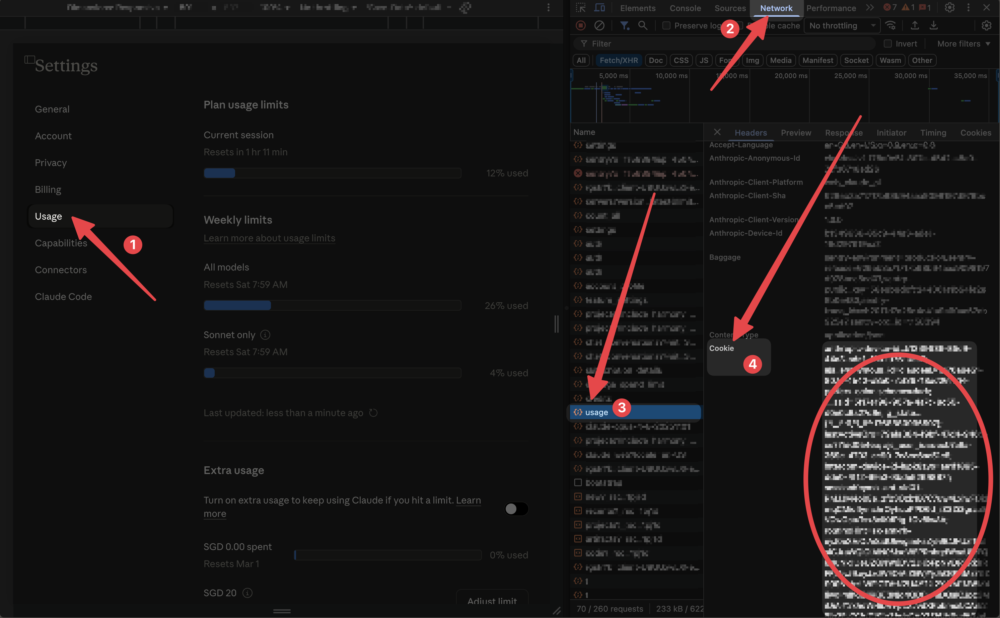

# ClaudeUsageBar

> Track your Claude.ai usage right from your Mac menu bar!

[](https://opensource.org/licenses/MIT)
[](https://www.apple.com/macos/)

<a href="https://www.producthunt.com/products/claudeusagebar?utm_source=badge-top-post-badge&utm_medium=badge&utm_campaign=badge-claudeusagebar" target="_blank"></a>

A lightweight, open-source macOS menu bar application that displays your Claude.ai session and weekly usage limits with real-time updates and notifications.

## 📥 Download

**[Download Latest Release](https://github.com/Artzainnn/claudeusagebar/releases)** (DMG Installer)

## 📦 Set Up

ClaudeUsageBar supports three ways to connect, configurable under **Account & Connection**:

1. **Automatic Claude Code detection** — If you are signed in to Claude Code, ClaudeUsageBar detects its macOS Keychain credentials automatically.
2. **Built-in Web Sign-In** — Click **"Sign in with Claude.ai"** to authenticate in an embedded `WKWebView` window.
3. **Manual Cookie (Advanced)** — Under **Advanced: Paste Cookie Manually**, paste a `Cookie` header from [claude.ai/settings/usage](https://claude.ai/settings/usage) (`Cmd+Option+I` → **Network** → `usage` request).

All web session cookies are stored securely in the macOS Keychain.



## ✨ Features

- 🟢 **Real-time usage tracking** - Monitor session (5-hour) and weekly (7-day) limits
- 🔑 **Flexible authentication** - Automatic Claude Code Keychain detection or built-in `"Sign in with Claude.ai"` (`WKWebView`)
- 🎨 **Color-coded menu bar icon** - Visual spark icon that changes color (green/yellow/red)
- 🔔 **Smart notifications** - Alerts at 25%, 50%, 75%, 90% usage thresholds
- ⌨️ **Keyboard shortcut** - Toggle popup with Cmd+U from anywhere
- ⚡ **Auto-refresh** - Updates every 5 minutes automatically and on Mac wake
- 🔒 **Privacy-first** - Credentials and cookies stored securely in the macOS Keychain on your Mac
- 📊 **Pro plan support** - Shows weekly Sonnet usage for Pro subscribers
- 🎯 **Menu bar only** - No Dock icon, stays out of your way

[See full feature list →](app/README.md)

## 🚀 Quick Start

1. **Download** `ClaudeUsageBar-Installer.dmg` from [Releases](https://github.com/Artzainnn/ClaudeUsageBar/releases)
2. **Open DMG** and drag ClaudeUsageBar to Applications folder
3. **Launch** ClaudeUsageBar from Applications
4. **Connect** via automatic Claude Code detection, **"Sign in with Claude.ai"**, or the advanced manual cookie option
5. **Done!** Usage appears in menu bar

## 📸 Screenshots

**Menu Bar Display:**
```
⚡ 45%  (Green spark icon when usage < 70%)
```

**Popup Interface:**
- Session (5-hour) usage with progress bar
- Weekly (7-day) usage with progress bar
- Weekly Sonnet usage (Pro plan only)
- Account & Connection controls and settings

## 📁 Repository Structure

```
app/        - macOS menu bar application (Swift/SwiftUI)
website/    - Landing page (HTML/CSS)
```

## 🛠️ Build from Source

**Requirements:**
- macOS 12.0 (Monterey) or later
- Xcode Command Line Tools

**Build the app:**
```bash
cd app
chmod +x build.sh
./build.sh
```

**Create DMG installer:**
```bash
./create_dmg.sh
```

The built app will be in `app/build/ClaudeUsageBar.app`

## 🔧 Development

### Project Structure

- `app/ClaudeUsageBar.swift` - Main application code
- `app/AuthSupport.swift` - Keychain storage, cookie normalization, ISO-8601 parsing, and web sign-in window
- `app/build.sh` - Build script (supports optional `CODESIGN_IDENTITY` override)
- `app/create_dmg.sh` - DMG installer creation
- `website/index.html` - Landing page

### Key Technologies

- **SwiftUI** - Modern macOS UI framework
- **AppKit** - Menu bar integration
- **WebKit** - Embedded `"Sign in with Claude.ai"` authentication flow
- **Security** - macOS Keychain storage for cookies and Claude Code credentials
- **Carbon** - Global keyboard shortcuts
- **NSUserNotification** - System notifications (no permissions needed)

## 🤝 Contributing

Contributions are welcome! Here's how you can help:

- 🐛 Report bugs via [Issues](https://github.com/Artzainnn/claudeusagebar/issues)
- 💡 Suggest features or improvements
- 🔧 Submit pull requests
- 📖 Improve documentation
- 🌍 Translate the website

## 📄 License

MIT License - see [LICENSE](LICENSE) for details

## ⚠️ Disclaimer

This app uses Claude.ai's internal API endpoints which may change without notice. It is not affiliated with or endorsed by Anthropic. Use at your own risk.

## 🙏 Support

If you find this useful, consider:
- ⭐ Starring this repository
- 📢 Sharing with others who use Claude

## 🔗 Links

- **Website:** [claudeusagebar.com](https://claudeusagebar.com)
- **Issues:** [GitHub Issues](https://github.com/Artzainnn/claudeusagebar/issues)
- **Releases:** [GitHub Releases](https://github.com/Artzainnn/claudeusagebar/releases)

## 🔗 Other projects

- **Mediaboost - Guaranteed PR feature:** [Mediaboost](https://mediaboost.press)
- **CheckWorth - AI net worth estimates from LinkedIn:** [CheckWorth](https://checkworth.app)

---

**Made with ❤️ for the Claude community**
